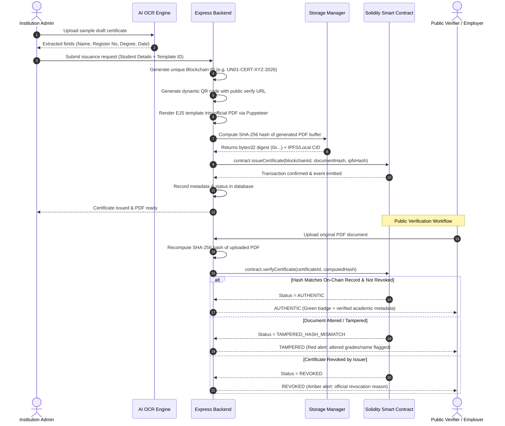

# Emertech Certify — System Architecture Specification

**Project Title**: AI-Assisted Blockchain-Based Academic Certificate Verification System  
**Developer & Maintainer**: Saqib Ahmad Bhat  
**Department**: Computer Science and Engineering  
**Institution**: Government College of Engineering, Tirunelveli  
**Academic Context**: AI and Blockchain Engineer Intern Demonstration (Emertech Innovations Private Limited context)  
**Based upon**: Certiport open-source project by Alwin James (MIT License)

---

## 1. Architectural Overview

Emertech Certify is designed as a modular, decentralized-capable academic credentialing platform. It bridges traditional institutional document generation with tamper-evident cryptographic storage on the Ethereum blockchain and machine-learning-assisted document extraction.

### Core Architectural Layers:

```
+-----------------------------------------------------------------------------------+
|                           PRESENTATION LAYER (REACT 19 SPA)                      |
|  - Modern Light Academic Theme (Navy #0f172a, Purple #6366f1)                     |
|  - Multi-Modal Verification Portal (ID Lookup, PDF Binary Upload, QR Scan)        |
|  - Role-Based Portals: Administrator Console, Institution Desk, Student Dashboard |
+-----------------------------------------------------------------------------------+
                                         |  HTTPS / REST (JWT Bearer Auth)
                                         v
+-----------------------------------------------------------------------------------+
|                           APPLICATION SERVER (EXPRESS.JS / NODE.JS)               |
|  - API Gateway & Route Protection (Role-Based Access Control)                     |
|  - AI OCR Microservice (Tesseract.js & PDF Stream Extractor)                      |
|  - Document Rendering Engine (Puppeteer Headless + EJS + QR Generator)            |
|  - Storage Fallback Manager (Pinata IPFS <-> Local Decentralized Storage)         |
+-----------------------------------------------------------------------------------+
             |                                              |
             v                                              v
+-----------------------------+               +-------------------------------------+
|      DATABASE LAYER         |               |          BLOCKCHAIN LAYER           |
|  - MongoDB (Mongoose 7)     |               |  - Solidity 0.8.19 Smart Contract   |
|  - Embedded Memory Fallback |               |  - SHA-256 Document Hash (bytes32)  |
|    (mongodb-memory-server)  |               |  - On-Chain Revocation & Events     |
|  - User, Request, Template, |               |  - Hardhat Local Node (31337) /     |
|    and Certificate Models   |               |    Ethereum Sepolia Testnet         |
+-----------------------------+               +-------------------------------------+
```

---

## 2. Multi-Modal Verification Mechanics

The system guarantees certificate authenticity through mathematical proof rather than relying solely on database records.

### SHA-256 Cryptographic Fingerprinting Workflow:



---

## 3. Storage Layer & Zero-Cost Offline Fallback Architecture

To ensure the application executes effortlessly during academic demonstrations without requiring paid third-party software subscriptions:

1. **Decentralized Storage Fallback**:
   - The application inspects environment variables for `PINATA_API_KEY` and `PINATA_API_SECRET`.
   - If credentials are valid, the file is pinned to IPFS via the Pinata Gateway.
   - If credentials are absent or fail, the system activates the **Local Storage Fallback**, generating an IPFS-compatible deterministic content identifier (`local-ipfs-${hash.slice(0,32)}`) and saving the physical PDF in `./uploads/certificates/`.
2. **Embedded Database Fallback**:
   - The database connector (`backend/config/db.js`) attempts to connect to `process.env.MONGO_URI` or the default local MongoDB daemon (`mongodb://127.0.0.1:27017/emertech_certify`).
   - If no MongoDB daemon is running, it automatically spins up an in-memory embedded MongoDB instance using `mongodb-memory-server`.
   - This provides immediate zero-configuration startup on any macOS or Linux laptop.

---

## 4. AI-Assisted Document Extraction (OCR) Architecture

The AI module implements lightweight, zero-cost information extraction to streamline certificate issuance:
- **Engine**: Local `Tesseract.js` neural optical character recognition coupled with `pdf-parse`.
- **Pipeline**:
  1. File Upload (`POST /api/ai/extract-ocr`): Accepts `.pdf`, `.png`, `.jpg`, `.webp`.
  2. Text Stream Parsing: Extracts vector text directly from PDF if available; falls back to Tesseract OCR for scanned certificates and images.
  3. Heuristic Field Classification: Applies regular expressions to detect student names, institution identities, registration numbers, degree titles, and issue dates.
  4. Human-in-the-Loop Confirmation: Pre-populates the issuance form and displays a clear disclaimer that an authorized administrator must verify all fields before signing on-chain.

---

## 5. Security & Access Control Model

| Layer | Security Mechanism | Description |
|---|---|---|
| **API Gateway** | JSON Web Tokens (JWT) | Signed with `JWT_SECRET`, 24-hour expiration, role verification (`admin`, `university`, `student`). |
| **Passwords** | Bcrypt (10 Salt Rounds) | Secure password hashing; plaintext passwords are never logged or stored. |
| **Frontend Routes** | `ProtectedRoute` Guard | Prevents unauthorized URL access; validates role permissions client-side. |
| **Smart Contract** | `onlyAuthorized` Modifier | Only registered institution wallets or the deployer can register certificates. |
| **Public Privacy** | Data Sanitization | Public verification endpoints omit sensitive student details (DOB, phone, physical address). |
| **CORS** | Configured Origins | Restricts cross-origin requests to configured frontend origins. |

