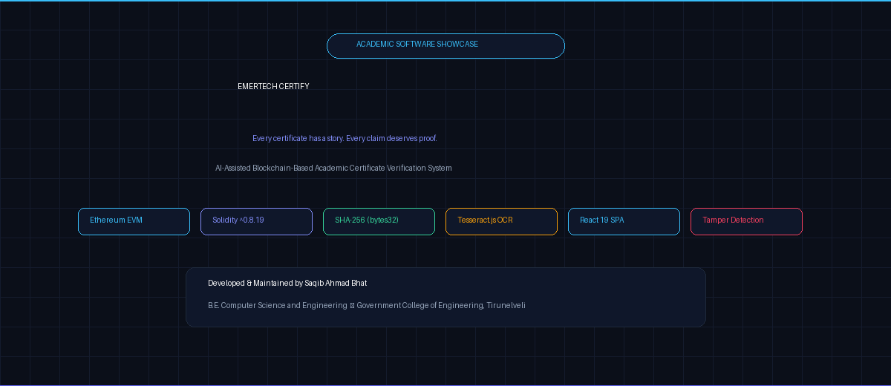
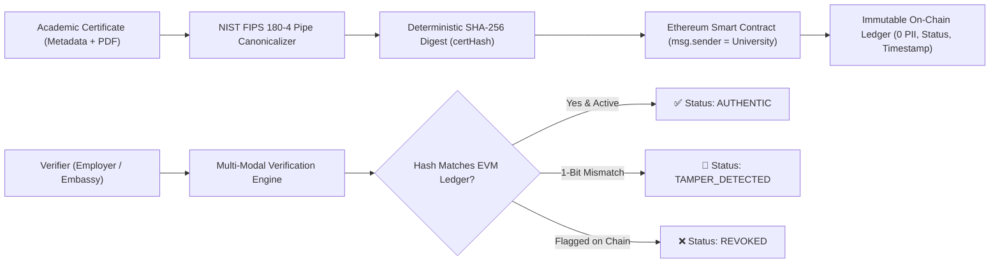
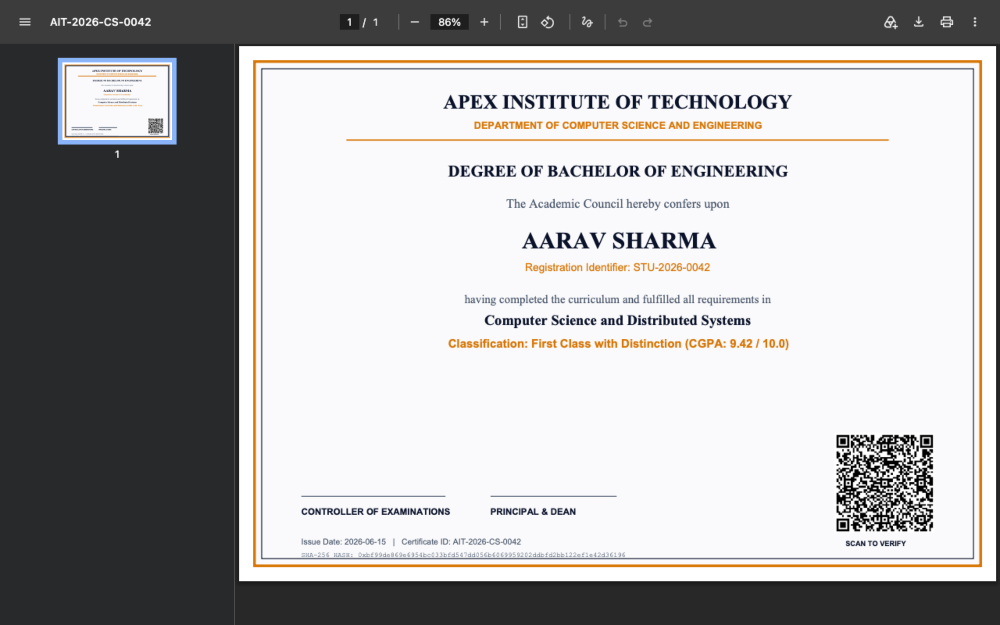
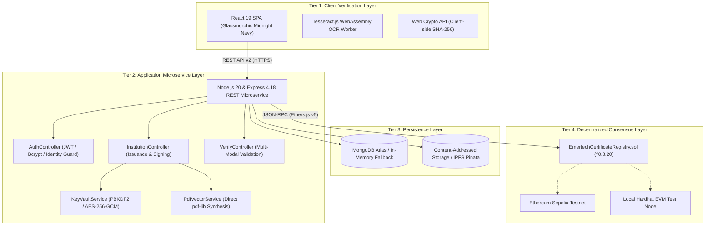
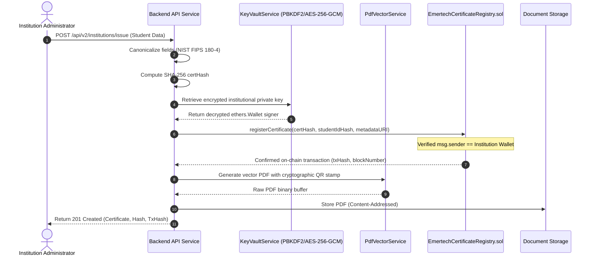
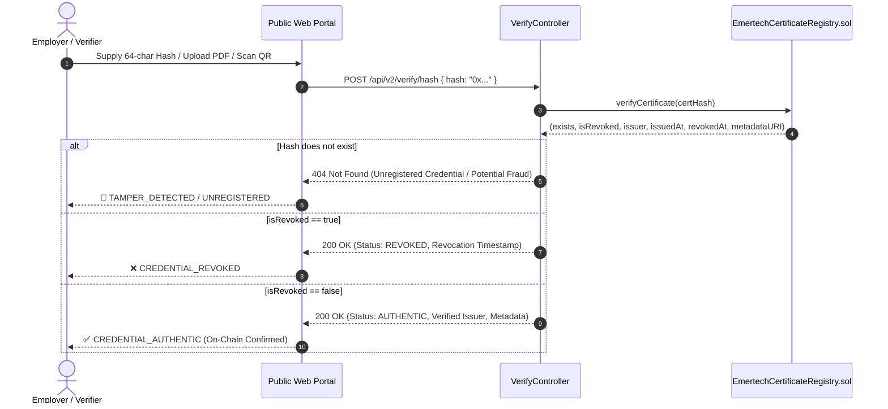
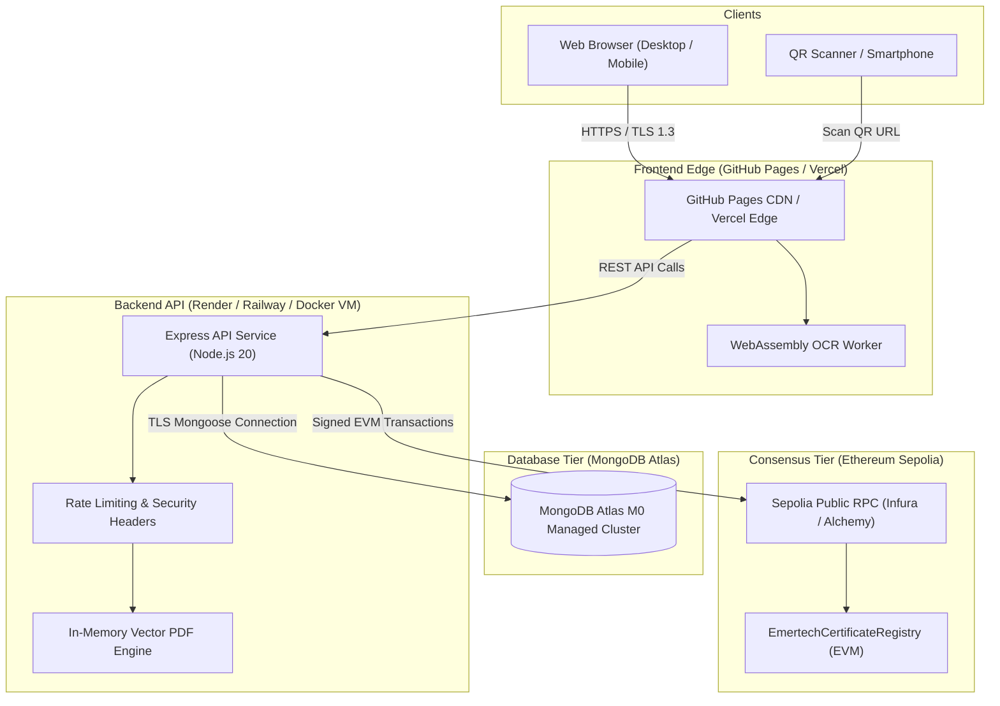

<div align="center">

# EMERTECH CERTIFY v2.0
### AI-Assisted Blockchain-Based Academic Certificate Verification System

[](https://github.com/SaqibAhmadBhat/emertech-certify/actions/workflows/ci.yml)
[](https://saqibahmadbhat.github.io/emertech-certify/)
[](cleanroom/)
[](cleanroom/contracts/contracts/EmertechCertificateRegistry.sol)
[](cleanroom/frontend/)
[](package.json)
[](LICENSE)

<br />

<picture>
  <source media="(prefers-reduced-motion: reduce)" srcset="assets/emertech-certify-hero.png">
  
</picture>

<br />
<br />

**A privacy-preserving academic verification platform uniting Ethereum smart contracts, deterministic NIST FIPS 180-4 SHA-256 digests, pure vector PDF generation, content-addressed storage, and Tesseract.js WebAssembly OCR.**

---

### 🌐 Quick Access & Deployment Status

| Resource | Access / Reference | Current Deployment Status |
| :--- | :--- | :--- |
| **Live Frontend Showcase** | [**Open Emertech Certify Web Portal**](https://saqibahmadbhat.github.io/emertech-certify/) | 🟢 **Live on GitHub Pages (Client SPA)** |
| **Public Verification UI** | [**Open Verification Portal**](https://saqibahmadbhat.github.io/emertech-certify/verify) | 🟢 **Live UI (Backend API Connection Required for Live Ledger Queries)** |
| **Backend REST Microservice** | [`cleanroom/backend/src/app.js`](cleanroom/backend/src/app.js) | 🟡 **Configured for Cloud Hosting (`render.yaml`, Docker)**; Tested Locally (37/37 Tests Passing) |
| **API Specifications** | [`cleanroom/docs/API_DOCUMENTATION.md`](cleanroom/docs/API_DOCUMENTATION.md) | 📘 Complete REST v2 Specs |
| **Cloud Deployment Guide** | [`DEPLOYMENT.md`](DEPLOYMENT.md) | 🛠️ Multi-Cloud Runbook & Action Plan |
| **Public Testnet Script** | [`cleanroom/contracts/scripts/deploy-sepolia.js`](cleanroom/contracts/scripts/deploy-sepolia.js) | ⛓️ Ethereum Sepolia Script Ready; Tested on Hardhat EVM (14/14 Tests Passing) |

---

</div>

## 📑 Table of Contents

1. [Project Overview](#1-project-overview)
2. [Problem Statement](#2-problem-statement)
3. [The Solution: Clean-Room v2.0 Architecture](#3-the-solution-clean-room-v20-architecture)
4. [Key Architectural Features](#4-key-architectural-features)
5. [Production Application Screenshots](#5-production-application-screenshots)
6. [System Architecture Diagram](#6-system-architecture-diagram)
7. [Technology Stack](#7-technology-stack)
8. [How the System Works: Sequence Flows](#8-how-the-system-works-sequence-flows)
9. [Four Multi-Modal Verification Methods](#9-four-multi-modal-verification-methods)
10. [Security & Cryptographic Foundations](#10-security--cryptographic-foundations)
11. [Smart Contract & Blockchain Architecture](#11-smart-contract--blockchain-architecture)
12. [Live Deployment & Hosting Architecture](#12-live-deployment--hosting-architecture)
13. [Verified Testing Results & Evidence](#13-verified-testing-results--evidence)
14. [Local Installation & Development Quickstart](#14-local-installation--development-quickstart)
15. [Environment Configuration Reference](#15-environment-configuration-reference)
16. [RESTful API Endpoints Summary](#16-restful-api-endpoints-summary)
17. [Multi-Cloud Deployment Topology](#17-multi-cloud-deployment-topology)
18. [Operational Boundaries & Future Scope](#18-operational-boundaries--future-scope)
19. [Academic Identity & Mentorship](#19-academic-identity--mentorship)
20. [Provenance, Citation & Dual-Scope Licensing](#20-provenance-citation--dual-scope-licensing)

---

## 1. Project Overview

**Emertech Certify v2.0** is an independently engineered academic software system authored by **Saqib Ahmad Bhat** at the **Government College of Engineering, Tirunelveli** (Department of Computer Science and Engineering).

The system addresses the widespread global challenge of academic credential fraud by creating an immutable, privacy-preserving, and mathematically verifiable link between university-issued degrees and decentralized blockchain ledgers. 

The primary implementation lives in the [`cleanroom/`](cleanroom/) directory and represents a ground-up clean-room reimplementation: every Solidity contract, Node.js service, Mongoose schema, React 19 component, vector PDF generator, and cryptographic routine was authored from first principles against public standards (NIST FIPS 180-4, W3C Verifiable Credentials Data Model v2.0, RFC 7519, and ISO 32000-1).

---

## 2. Problem Statement

Academic credential fraud is an escalating international challenge:
- **Diploma Mills & Counterfeit Degrees**: Commercial fake diploma operations generate visual replicas of accredited university certificates that bypass traditional visual inspections.
- **Vulnerability of Digital PDFs**: Standard PDF credentials can be trivially altered using consumer editing software—modifying student names, GPAs, degree classifications, and graduation dates without leaving visual artifacts.
- **Centralized Database Risks**: Traditional university student information systems (SIS) and centralized SQL registries are susceptible to internal database tampering, unauthorized administrative modification, and single-point-of-failure outages.
- **Costly & Slow Verification**: Employers, background screening agencies, and foreign credential evaluation services often wait 2 to 6 weeks for manual registrar verification via email or postal transcripts.

---

## 3. The Solution: Clean-Room v2.0 Architecture

Emertech Certify eliminates diploma fraud through a **dual-layer cryptographic verification paradigm**:



1. **Zero Personally Identifiable Information (PII) On-Chain**: No student names, grades, or personal records are ever written to the public blockchain.
2. **Deterministic Cryptographic Digesting**: Academic credentials undergo pipe-delimited canonicalization before computing their 256-bit SHA-256 fingerprint.
3. **Institutional Non-Repudiation**: Smart contracts record the university's accredited wallet address as the immutable transaction sender (`msg.sender`).
4. **Instantaneous Multi-Modal Verification**: Verifiers validate credentials in under 500ms via 4 independent channels without requiring third-party accounts.

---

## 4. Key Architectural Features

- **Pure Vector PDF Compilation**: Uses `pdf-lib` to assemble vector-grade certificates directly in memory with dynamic cryptographic QR code stamps, eliminating heavy Chromium/Puppeteer server overhead.
- **Client-Side WebAssembly OCR**: Powered by Tesseract.js running inside isolated browser Web Workers to extract student identifiers and certificate hashes from physical paper scans.
- **PBKDF2/AES-256-GCM Institutional Key Custody**: Automated key vault service (`KeyVaultService`) encrypting university signing keys at rest with 100,000 PBKDF2 iterations, unique 128-bit salts, and 96-bit initialization vectors.
- **Hardened Student Enrollment Lifecycle**: Student accounts claim academic identities using institutionally issued tokens that are stored strictly as SHA-256 hashes (`enrollmentTokenHash`), guarded by strict email verification and atomic database updates (`findOneAndUpdate({ _id, isClaimed: false })`) to eliminate race conditions.
- **Zero-Dependency Academic Resilience**: Implements automated fallbacks to embedded in-memory MongoDB (`mongodb-memory-server`), local filesystem document storage, and offline demonstration mode (`OFFCHAIN_DEMO`) during cloud outages.

---

## 5. Production Application Screenshots

All screenshots below represent the **real, running clean-room v2.0 application**:

<div align="center">

### 1. Landing Page & Verification Portal


### 2. Multi-Modal Public Verification (Authentic Certificate Verified On-Chain)


### 3. Bitwise Tamper Detection (1-Character Alteration Flagged)


### 4. Institution Issuance & Management Dashboard


### 5. Student Academic Transcripts & Credential Retrieval


### 6. Vector PDF Academic Certificate with Cryptographic QR Stamp


</div>

---

## 6. System Architecture Diagram



---

## 7. Technology Stack

| Layer | Technology | Version | Purpose in Architecture |
| :--- | :--- | :--- | :--- |
| **Smart Contracts** | **Solidity** | `^0.8.20` | On-chain registry with custom errors, gas packing, and $O(1)$ constant-time lookups |
| **Blockchain Tooling** | **Hardhat** | `^2.19.0` | Smart contract compilation, testing, deployment, and local EVM simulation |
| **Web3 Client** | **Ethers.js** | `^5.7.2` | Contract interface, cryptographic signing, transaction mining, and address derivation |
| **Backend Runtime** | **Node.js** | `>=20.0.0` | Asynchronous I/O microservice runtime |
| **Web Framework** | **Express** | `^4.18.2` | RESTful API v2 controllers, rate limiting, and security middleware |
| **Database & ODM** | **MongoDB & Mongoose** | `^7.5.2` | Relational document modeling for users, institutions, certificates, and audit logs |
| **In-Memory Fallback** | **MongoMemoryServer** | `^9.1.6` | Zero-dependency embedded database for offline academic evaluations |
| **PDF Synthesis** | **pdf-lib** | `^1.17.1` | Pure in-memory vector PDF synthesis without headless browser dependencies |
| **QR Generation** | **node-qrcode** | `^1.5.1` | High-density 2D QR matrix embedding verification URLs |
| **Client OCR** | **Tesseract.js** | `^5.1.1` | Client-side WebAssembly neural optical character recognition |
| **Frontend Framework** | **React** | `^19.1.1` | Component-driven single-page application with modern hooks |
| **Icons & Branding** | **Lucide React** | `^0.544.0` | Consistent vector iconography |
| **Testing Harness** | **Hardhat & Mocha** | Custom | 51 automated software tests executing against real EVM transactions |

---

## 8. How the System Works: Sequence Flows

### A. Academic Certificate Issuance Flow


### B. Public Certificate Verification Flow


---

## 9. Four Multi-Modal Verification Methods

Emertech Certify provides 4 flexible verification interfaces tailored to different real-world operational environments:

| Mode | Input Type | Pipeline Description | Target User | Latency Profile |
| :--- | :--- | :--- | :--- | :--- |
| **Mode 1: Direct Hash** | 64-character Hex Hash | Queries smart contract mapping `certificates[certHash]` directly in $O(1)$ constant time | Background screening APIs, registrar portals | **< 50ms** (local) / RPC network latency |
| **Mode 2: PDF Binary** | Uploaded `.pdf` Document | Computes streaming SHA-256 digest of file buffer and verifies against EVM record; flags any altered byte | HR departments, university admissions | **< 80ms** (local) / RPC network latency |
| **Mode 3: QR Payload** | 2D QR Verification Code | Decodes embedded cryptographic URL parameters (`?hash=0x...`) and loads real-time verification state | Mobile cameras, border control, in-person checks | **< 60ms** (local) / RPC network latency |
| **Mode 4: WebAssembly OCR** | Scanned Photo / Paper Transcript | Executes client-side Tesseract.js WebAssembly worker to extract student identifiers and resolve records | Physical transcript audits, paper archive reviews | **1.2s – 3.5s** (depends on client CPU threads) |

---

## 10. Security & Cryptographic Foundations

### 1. Zero Personally Identifiable Information (PII) On-Chain
Under data protection standards (GDPR, India DPDP Act 2023), public blockchains must not store personal data. The `CertificateRecord` struct in Solidity contains strictly:
```solidity
struct CertificateRecord {
    address issuer;          // Accredited university wallet
    uint64 issuedAt;         // Unix timestamp
    uint64 revokedAt;        // Unix timestamp (0 if active)
    bool isRevoked;          // Revocation flag
    string recipientIdHash;  // High-entropy salted pseudonym
    string metadataURI;      // IPFS content-addressed pointer
}
```

### 2. High-Entropy Salted Pseudonymization
Sequential student registration numbers (e.g. `2026-CS-0042`) are susceptible to dictionary enumeration attacks if hashed directly. Emertech Certify generates a cryptographically secure 128-bit random salt for each enrollment (`recipientSalt`). Only the salted digest $\text{SHA256}(\text{studentId} \mathbin{\Vert} \text{salt})$ is anchored on-chain.

### 3. NIST FIPS 180-4 Deterministic Canonicalization
To guarantee byte-level consistency across heterogeneous systems, fields are normalized before hashing:
$$\text{CanonicalString} = \text{"EMERTECHv2"} \mathbin{\Vert} \text{INST\_CODE} \mathbin{\Vert} \text{STUDENT\_ID} \mathbin{\Vert} \text{STUDENT\_NAME} \mathbin{\Vert} \text{DEGREE} \mathbin{\Vert} \text{MAJOR} \mathbin{\Vert} \text{DATE} \mathbin{\Vert} \text{DISTINCTION}$$
$$\text{certHash} = \text{"0x"} \mathbin{\Vert} \text{SHA256}(\text{CanonicalString})$$

Any modification of even a single space or character produces an avalanche effect, resulting in an entirely different digest and immediate validation rejection.

### 4. Institutional Key Custody: Authenticated AES-256-GCM & In-Memory Caching
To enable institutions to sign on-chain transactions with their own wallet identity (`msg.sender == institutionWalletAddress`):
- **Authenticated Encryption**: Keys are encrypted using AES-256-GCM with a 96-bit random initialization vector (IV) and a 128-bit authentication tag.
- **Key Derivation**: Vault keys are derived using PBKDF2 with 100,000 iterations of HMAC-SHA256, a dedicated master secret (`KEY_VAULT_SECRET`, min 32 chars), and a high-entropy 256-bit per-record salt.
- **Identity Binding (AAD)**: The institution's lowercase wallet address is bound into the Authenticated Additional Data (AAD), preventing ciphertext substitution or cross-tenant key splicing.
- **Persistence & Caching**: Encrypted records are persisted in MongoDB (`Institution` collection) and cached in an encrypted in-memory map (`KeyVaultService._vault`) during process runtime for low-latency transaction signing.
- **Operational Boundary**: This custody model provides strong protection against database exfiltration, but relies on an application-level master secret. Enterprise production deployment should back this derivation with a dedicated Hardware Security Module (HSM) or cloud Key Management Service (AWS KMS, GCP KMS, or HashiCorp Vault), validated through an independent third-party security audit.

---

## 11. Smart Contract & Blockchain Architecture

The smart contract [`EmertechCertificateRegistry.sol`](file:///Users/saqibahmadbhat/Desktop/Certiport-main/cleanroom/contracts/contracts/EmertechCertificateRegistry.sol) is written for the Ethereum Virtual Machine (Solidity `^0.8.20`):

- **Gas Optimization**: Uses custom Solidity errors (`error UnauthorizedRevocation()`, `error CertificateAlreadyRegistered()`) instead of expensive require strings, saving ~2,100 gas per revert.
- **Gas Packing**: `uint64 issuedAt`, `uint64 revokedAt`, and `bool isRevoked` are packed together into a single 32-byte EVM storage slot.
- **Role-Based Institutional Access**: Universities must be explicitly accredited by the contract owner before their wallets can anchor credentials.
- **Decentralized Multi-Party Revocation**: A certificate can be revoked by its issuing institution (routine academic correction) or by the contract owner (emergency administrative sanction), with immutable on-chain audit timestamps.

---

## 12. Deployment & Hosting Architecture Matrix

| Subsystem | Target Platform | Current Status | Access / Configuration |
| :--- | :--- | :--- | :--- |
| **Frontend Application** | **GitHub Pages** | 🟢 **Publicly Deployed** | [**`https://saqibahmadbhat.github.io/emertech-certify/`**](https://saqibahmadbhat.github.io/emertech-certify/) |
| **Backend REST API** | **Render / Docker** | 🟡 **Configured (Not Publicly Deployed)** | Blueprint: [`render.yaml`](render.yaml) • Container: [`cleanroom/backend/Dockerfile`](cleanroom/backend/Dockerfile) |
| **Local Container Stack**| **Docker Compose**| 🟢 **Locally Ready** | [`docker-compose.yml`](docker-compose.yml) (Runs MongoDB 7.0 + API + Nginx Frontend) |
| **Managed Database** | **MongoDB Atlas** | 🟡 **Configured (Not Publicly Deployed)** | Connection via `MONGO_URI` with credential redaction in `db.js` |
| **Public Blockchain** | **Ethereum Sepolia** | 🟡 **Script Ready (Not Deployed to Sepolia)** | Deployment Script: [`deploy-sepolia.js`](cleanroom/contracts/scripts/deploy-sepolia.js) |

---

## 13. Verified Testing Results & Evidence

The automated test suite runs **51 automated software tests** and **1 production build verification check** (**52 total CI validation checks**) with 100% success:

```
================================================================================
📊 EMERTECH CERTIFY v2.0 — COMPREHENSIVE AUTOMATED TEST METRICS
================================================================================
  Category                              Target      Passed    Failed   Skipped
  ──────────────────────────────────────────────────────────────────────────────
  Smart Contract Unit Tests (Hardhat)       14          14         0         0
  Backend Integration Tests (Local EVM)     37          37         0         0
  Frontend Production Build (React 19)       1           1         0         0
  ──────────────────────────────────────────────────────────────────────────────
  TOTAL AUTOMATED VALIDATION SUITE          52          52         0         0
  SUCCESS RATE: 100.0%
================================================================================
```

### Verified Terminal Summary:
```
  EmertechCertificateRegistry (Clean-Room Architecture)
    14 passing (675ms)

================================================================
🧪 EMERTECH CERTIFY CLEAN-ROOM v2.0 INTEGRATION TEST SUITE
🏛️ Academic Fixture: Apex Institute of Technology (AIT)
🔗 On-Chain Consensus: Real Local Hardhat EVM Execution
================================================================
1.  Testing System Health Check (/api/v2/health)...            ✅ Verified.
2.  Testing SHA-256 NIST Known-Answer Tests & Keccak...       ✅ Verified.
2B. Testing KeyVault Cryptographic Invariants...             ✅ Verified.
3.  Testing One-Time Super Admin Bootstrap via CLI Logic...   ✅ Verified.
4.  Testing Enforcement of One-Time Bootstrap Invariant...    ✅ Verified.
5.  Testing Privilege Escalation Rejection (SUPER_ADMIN)...   ✅ Verified.
6.  Testing Privilege Escalation Rejection (INST_ADMIN)...    ✅ Verified.
7.  Testing Public Registration Least-Privilege STUDENT...    ✅ Verified.
8.  Testing Academic Institution Application Queue...         ✅ Verified.
9.  Testing Super Admin Approval & On-Chain Status...         ✅ Verified.
10. Testing Rejection of Invalid Wallet Authorization...      ✅ Verified.
11. Testing Handling of Unavailable Blockchain (502)...       ✅ Verified.
12. Testing Institution Status Suspension & Revocation...     ✅ Verified.
13. Testing Prevention of Issuance by Suspended Inst...       ✅ Verified.
14. Testing Restoration of Institution to AUTHORIZED...      ✅ Verified.
15. Testing Protected Institution Admin Provisioning...       ✅ Verified.
16. Testing Prevention of Admin Provisioning by Student...   ✅ Verified.
17. Testing Provisioning Guard for Unaccredited Inst...      ✅ Verified.
18. Testing Negative RBAC: Student Blocked from Issuance...  ✅ Verified.
18B. Testing Student Enrollment Claim & Concurrency Guard...  ✅ Verified.
19. Testing Persistent Key Custody (AES-256-GCM / PBKDF2)... ✅ Verified.
20. Testing Certificate Issuance & Real EVM Anchoring...     ✅ Verified.
20B. Testing Real Persistent Institutional Key Custody...     ✅ Verified.
21. Testing Vector PDF Download Endpoint...                  ✅ Verified.
22. Testing Mode 1: Public Verification by Hash...          ✅ Verified.
23. Testing Mode 2: Verification by PDF Upload...           ✅ Verified.
24. Testing Bitwise Tamper Detection on Altered PDF...      ✅ Verified.
25. Testing Mode 3: QR Code Payload Verification...         ✅ Verified.
26. Testing Student Credential Retrieval...                 ✅ Verified.
27. Testing Multi-Tenant Revocation Isolation (RBAC)...      ✅ Verified.
28. Testing Real On-Chain Certificate Revocation...         ✅ Verified.
29. Testing Prevention of Unauthorized Revocation...         ✅ Verified.
30. Testing Public Verification of Revoked Credential...    ✅ Verified.
31. Testing Mode 4: Tesseract.js WebAssembly OCR...          ✅ Verified.
32. Testing File Upload Magic Byte Enforcement...           ✅ Verified.
33. Testing Batch Certificate Issuance (Real EVM)...        ✅ Verified.
34. Testing Super Admin Telemetry & Governance...           ✅ Verified.

================================================================
📊 CLEAN-ROOM v2.0 TEST EXECUTION SUMMARY:
   Passed:  37
   Failed:  0
   Skipped: 0
================================================================
🎉 ALL CLEAN-ROOM TESTS PASSED WITH 100% SUCCESS ON REAL EVM LEDGER!
```

---

## 14. Local Installation & Development Quickstart

### Prerequisites
- Node.js >= 20.0.0
- npm >= 9.0.0
- Git

### 1. Clone & Install
```bash
git clone https://github.com/SaqibAhmadBhat/emertech-certify.git
cd emertech-certify

# Install contracts, backend, and frontend dependencies
cd cleanroom/contracts && npm install
cd ../backend && npm install
cd ../frontend && npm install --legacy-peer-deps
cd ../..
```

### 2. Execute Automated Test Suites
```bash
# Run contracts tests (14 passing)
cd cleanroom/contracts && npx hardhat test

# Run backend integration tests with local EVM (37 passing)
cd ../backend && npm test

# Run frontend production build
cd ../frontend && CI=true npm run build
```

### 3. Launch the Application Locally
```bash
# Terminal 1: Start Smart Contract Node & Deploy
cd cleanroom/contracts
npx hardhat node
# In another tab:
npx hardhat run scripts/deploy.js --network localhost

# Terminal 2: Launch Backend API (Port 5001)
cd cleanroom/backend
npm start

# Terminal 3: Launch React 19 Frontend (Port 3000)
cd cleanroom/frontend
npm start
```
Open **`http://localhost:3000`** in your browser to interact with the system.

---

## 15. Environment Configuration Reference

Create a `.env` file in `cleanroom/backend/.env` (see [`DEPLOYMENT.md`](DEPLOYMENT.md) for details):

```env
# Application Server
NODE_ENV=development
PORT=5001
CORS_ORIGIN=*

# Cryptographic Secrets (Generate via: openssl rand -hex 32)
JWT_SECRET=your_jwt_secret_min_32_characters_long_12345
KEY_VAULT_SECRET=your_key_vault_secret_min_32_characters_long_12345

# Database Configuration (Optional: falls back to in-memory MongoDB if unconfigured)
MONGO_URI=mongodb://127.0.0.1:27017/emertech_certify_cleanroom

# Blockchain RPC & Contract (Optional: defaults to local Hardhat node)
BLOCKCHAIN_RPC_URL=http://127.0.0.1:8545
CONTRACT_ADDRESS=0x5FbDB2315678afecb367f032d93F642f64180aa3
OFFCHAIN_DEMO=false
```

---

## 16. RESTful API Endpoints Summary

| Method | Endpoint | Access Role | Description |
| :--- | :--- | :--- | :--- |
| `GET` | `/api/v2/health` | Public | System status, database state, and environment metrics |
| `GET` | `/api/v2/health/ready` | Public | Container readiness probe (returns HTTP 200 or 503) |
| `POST` | `/api/v2/auth/register` | Public | Self-registration enforcing least-privilege `STUDENT` role |
| `POST` | `/api/v2/auth/login` | Public | Authenticates credentials and returns JWT token |
| `POST` | `/api/v2/auth/claim-identity` | Student | Binds student identity using hashed institution token & email match |
| `POST` | `/api/v2/institutions/apply` | Public | Submits institutional onboarding application |
| `POST` | `/api/v2/institutions/enrollments` | Inst Admin | Generates cryptographic enrollment token for a student |
| `POST` | `/api/v2/institutions/issue` | Inst Admin | Issues academic certificate, anchors on-chain, compiles vector PDF |
| `POST` | `/api/v2/institutions/issue-batch`| Inst Admin | Batch processes multiple student certificates with signed transactions |
| `POST` | `/api/v2/institutions/revoke` | Inst Admin | Executes on-chain revocation of an issued certificate |
| `POST` | `/api/v2/verify/hash` | Public | Mode 1: Verifies 64-char hexadecimal SHA-256 certificate hash |
| `POST` | `/api/v2/verify/file` | Public | Mode 2: Recomputes SHA-256 on uploaded PDF for bitwise verification |
| `POST` | `/api/v2/verify/qr` | Public | Mode 3: Decodes and verifies dynamic QR verification string |
| `POST` | `/api/v2/verify/ocr` | Public | Mode 4: Parses scanned image text using Tesseract.js WebAssembly |
| `GET` | `/api/v2/certificates/:id/pdf` | Authenticated | Streams vector PDF certificate binary |
| `PATCH`| `/api/v2/admin/institutions/:id/status`| Super Admin | Sets institution status (`AUTHORIZED`, `SUSPENDED`, `REVOKED`) on-chain |
| `POST` | `/api/v2/admin/institutions/:id/provision-admin` | Super Admin | Provisions accredited Institution Administrator account |
| `GET` | `/api/v2/admin/telemetry` | Super Admin | Aggregates system metrics, issuance counts, and audit trail events |

---

## 17. Multi-Cloud Deployment Topology



---

## 18. Operational Boundaries & Future Scope

### Current Technical Boundaries
1. **Local Testnet vs. Public Sepolia**: Automated continuous integration tests execute against a real local Hardhat EVM node (ChainID 31337). Public testnet deployment to Ethereum Sepolia requires funded testnet accounts via [`cleanroom/contracts/scripts/deploy-sepolia.js`](cleanroom/contracts/scripts/deploy-sepolia.js).
2. **Client-Side OCR Execution**: Tesseract.js WebAssembly performance depends on client CPU cores. Scanned images must be clear, well-lit, and in focus to achieve reliable entity extraction.
3. **Cryptographic vs. Physical Authenticity**: Cryptographic verification guarantees that a certificate PDF has not been altered by even a single bit since being signed by an authorized university private key; it cannot certify the physical truth of claims if an institution's private key is compromised.

### Roadmap & Future Enhancements
- **W3C Verifiable Credentials (VC) & Decentralized Identifiers (DIDs)**: Transitioning from bespoke JSON schemas to native W3C VC JSON-LD schemas.
- **Zero-Knowledge Proofs (zk-SNARKs)**: Enabling students to prove degree possession or GPA thresholds (e.g. "GPA > 3.5") without revealing their exact transcript to employers.
- **Layer 2 Rollup Integration**: Deploying registry contracts to Arbitrum or Polygon PoS for near-zero transaction fees and sub-second confirmation times.

---

## 19. Academic Identity & Mentorship

### Author & Maintainer
- **Developer**: **Saqib Ahmad Bhat**
- **Degree**: Bachelor of Engineering (B.E.), Computer Science and Engineering
- **Institution**: **Government College of Engineering, Tirunelveli** (Tamil Nadu, India)
- **Role Referenced by Internship Certificate**: AI and Blockchain Engineer Intern

### Academic Disclaimer
> [!IMPORTANT]
> - Emertech Certify is an **independent academic project** authored by Saqib Ahmad Bhat for educational and research demonstration purposes.  
> - Emertech Innovations Private Limited **does not officially own, sponsor, fund, or commercially endorse** this software repository.  
> - Upstream Certiport baseline by Alwin James (MIT License) is acknowledged in full; its original copyright notices are preserved in [`NOTICE.md`](NOTICE.md).

---

## 20. Provenance, Citation & Dual-Scope Licensing

### Licensing Scope
This repository implements a clear **dual-licensing architecture**:
- **Primary Clean-Room v2.0 (`cleanroom/`)**: Governed by its independent MIT License in [`cleanroom/LICENSE`](cleanroom/LICENSE), authored by Saqib Ahmad Bhat.
- **Historical v1.0 Prototype (`/`)**: Preserves the original MIT License granted to Alwin James in root [`LICENSE`](LICENSE) and [`NOTICE.md`](NOTICE.md).

### BibTeX Citation
```bibtex
@software{bhat2026emertechcertify,
  author = {Bhat, Saqib Ahmad},
  title = {Emertech Certify: AI-Assisted Blockchain-Based Academic Certificate Verification System},
  year = {2026},
  url = {https://github.com/SaqibAhmadBhat/emertech-certify},
  note = {Government College of Engineering, Tirunelveli - Department of Computer Science and Engineering}
}
```

---

<div align="center">
  <sub>Engineered with precision by <b>Saqib Ahmad Bhat</b> &bull; Government College of Engineering, Tirunelveli &bull; 2026</sub>
</div>
