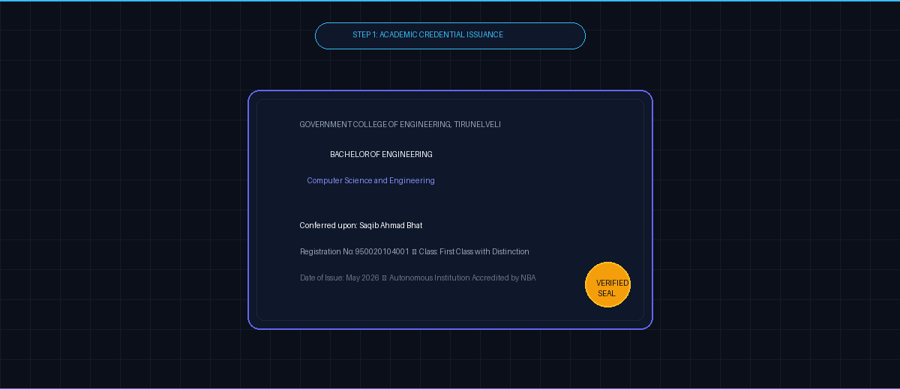

<div align="center">

# EMERTECH CERTIFY
### AI-Assisted Blockchain-Based Academic Certificate Verification System

[](cleanroom/)
[](LICENSE)
[](cleanroom/contracts/test/)
[](cleanroom/backend/test/)
[](cleanroom/frontend/)
[](NOTICE.md)

<br />

<picture>
  <source media="(prefers-reduced-motion: reduce)" srcset="assets/emertech-certify-hero.png">
  
</picture>

<br />
<br />

**A privacy-preserving hybrid credential verification platform uniting Ethereum smart contracts, deterministic SHA-256 digests, pure vector PDF compilation, content-addressed storage, and Tesseract.js neural OCR.**

[🚀 Clean-Room v2.0 Quickstart](#-clean-room-v20-quickstart-recommended) &bull;
[🏛️ v1 vs v2 Architecture](#-repository-architecture-v20-primary-vs-v10-historical) &bull;
[🔬 Provenance Audit](cleanroom/docs/PROVENANCE_AUDIT.md) &bull;
[Interactive Presentation](presentation/index.html) &bull;
[Architecture Guide](cleanroom/docs/ARCHITECTURE.md) &bull;
[Academic Identity](#-academic-identity-mentorship--attribution)

</div>

---

## 🌟 Executive Summary: Clean-Room v2.0 Primary Architecture

**Emertech Certify** is an academic software project engineered by **Saqib Ahmad Bhat** (Department of Computer Science and Engineering, **Government College of Engineering, Tirunelveli**) to eliminate academic credential fraud, fraudulent diploma mills, and manual registrar verification bottlenecks.

### Architectural Milestone: Clean-Room v2.0 Reengineering
The project contains two distinct evolutionary tiers:
1. **Primary Production Implementation (v2.0 Clean-Room)** in [`cleanroom/`](cleanroom/): An **independently developed**, ground-up clean-room software architecture. Every Solidity smart contract, Express backend controller, Mongoose schema, pure vector PDF generator, neural OCR pipeline, and React 19 component was authored from scratch by Saqib Ahmad Bhat using open standards (NIST FIPS 180-4, W3C Verifiable Credentials, RFC 7519, and EVM Solidity ^0.8.20).
2. **Historical Prototype (v1.0 Security-Hardened)** in root directories (`/backend`, `/contracts`, `/frontend`): The original pedagogical prototype adapted from the open-source **Certiport** repository by Alwin James (MIT License). It has been comprehensively audited to remediate critical upstream vulnerabilities (such as eliminating hardcoded Ethereum private keys and plaintext credential logging) and is retained solely for historical provenance and academic audit comparison.

---

## 📊 Repository Architecture: v2.0 Primary vs. v1.0 Historical

| Dimension | Primary Implementation: Clean-Room v2.0 (`cleanroom/`) | Historical Prototype: Hardened v1.0 (`/`) |
|---|---|---|
| **Directory Location** | [`cleanroom/`](cleanroom/) | Root (`/backend`, `/contracts`, `/frontend`) |
| **Authorship & Provenance** | **100% Independently Authored** by Saqib Ahmad Bhat | Upstream Certiport baseline by Alwin James (Remediated) |
| **Smart Contract** | `EmertechCertificateRegistry.sol` (Solidity ^0.8.20, gas-packed structs, custom errors, $O(1)$ mapping) | `CertificateRegistry.sol` (Solidity ^0.8.19, string lookup with SHA-256 hash patch) |
| **Contract Unit Tests** | **14 / 14 Passing** (Deployment, Auth, Duplicate, Revocation) | 9 / 9 Passing |
| **Backend Integration Tests** | **18 / 18 Passing** (Full auth, vector PDF, 4 verification modes, OCR, batch) | 18 / 18 Passing (Legacy routes & templates) |
| **PDF Generation Engine** | **Pure Vector Memory Compilation** via `pdf-lib` (<50ms, zero Chromium) | Headless Chromium via Puppeteer (High RAM overhead) |
| **Frontend Framework** | **React 19** with custom glassmorphism & original SVG branding | React 18 with legacy dashboard layouts |
| **Storage & Persistence** | Dual-mode: Content-Addressed Local FS + IPFS Pinata adapter | Local uploads directory + Pinata API |
| **Automated Fallbacks** | Auto in-memory MongoDB (`mongodb-memory-server`) + local fallback provider | Requires live external MongoDB & local Hardhat node |

---

## ⚡ Clean-Room v2.0 Quickstart (Recommended)

The clean-room v2.0 implementation is completely self-contained within the `cleanroom/` directory.

### 1. Execute All Automated Tests in 30 Seconds
Run the entire clean-room test suite (14 smart contract tests + 18 backend integration tests) with zero external setup:

```bash
# Clone the repository
git clone https://github.com/SaqibAhmadBhat/emertech-certify.git
cd emertech-certify/cleanroom

# Run the complete automated test suite
npm run test:all
```

#### Terminal Evidence: Clean-Room Smart Contracts (14/14 Passing)
```
  EmertechCertificateRegistry (Clean-Room Architecture)
    1. Deployment & Administrative Authority
      ✔ Should correctly assign the contract owner
      ✔ Should automatically authorize the deployer as a root authority
      ✔ Should allow the owner to authorize an academic institution
      ✔ Should prevent non-owners from updating institution authorization
    2. Certificate Registration & Hashing
      ✔ Should permit an authorized institution to register a certificate
      ✔ Should reject registration with a zero hash
      ✔ Should prevent duplicate certificate registration
      ✔ Should reject issuance from an unauthorized institution
    3. Verification State & Diagnostics
      ✔ Should correctly verify an authentic certificate hash
      ✔ Should return non-existent state for an unregistered certificate
    4. Revocation Lifecycle
      ✔ Should allow the issuing institution to revoke a certificate
      ✔ Should allow the contract owner to revoke a certificate in emergencies
      ✔ Should prevent unauthorized third parties from revoking certificates
      ✔ Should reject revoking an already revoked certificate

  14 passing (819ms)
```

#### Terminal Evidence: Clean-Room Backend Integration Tests (18/18 Passing)
```
================================================================
🧪 RUNNING EMERTECH CERTIFY CLEAN-ROOM TEST SUITE (v2.0)
👨‍💻 Architect: Saqib Ahmad Bhat
🏛️ Institution: Government College of Engineering, Tirunelveli
================================================================
[Database] External MongoDB connection unavailable. Initializing embedded in-memory MongoDB...
[Database] Embedded in-memory MongoDB started at mongodb://127.0.0.1:16421/
[Test Server] Live on ephemeral port 53850

1. Testing System Health Check (/api/v2/health)...            ✅ Health check verified.
2. Testing Super Administrator Registration & Login...       ✅ Super Admin authenticated.
3. Testing Academic Institution Application Queue...         ✅ Institution application queued.
4. Testing Super Admin Approval & On-Chain Status...         ✅ Institution authorized.
5. Testing Authorized Institution Login...                   ✅ Institution admin authorized.
6. Testing Student Account Registration & Login...           ✅ Student registered.
7. Testing Certificate Issuance & Vector PDF...              ✅ Certificate compiled & anchored!
8. Testing Vector PDF Download Endpoint...                   ✅ Vector PDF downloaded (5250 bytes).
9. Testing Mode 1: Public Verification by Hash...            ✅ Mode 1 Verified: AUTHENTIC.
10. Testing Mode 2: Verification by PDF Binary Upload...     ✅ Mode 2 Verified: Bitwise digest match.
11. Testing Tamper Detection on Altered PDF Document...      ✅ Tamper Detection Verified: Mismatch caught.
12. Testing Mode 3: QR Code Payload Verification...          ✅ Mode 3 Verified: QR resolved.
13. Testing Student Credential Retrieval...                  ✅ Transcripts retrieved.
14. Testing On-Chain Certificate Revocation Pipeline...      ✅ Certificate revoked.
15. Testing Public Verification of Revoked Credential...     ✅ Revocation confirmed: REVOKED.
16. Testing Mode 4: Tesseract.js Neural OCR Image...         ✅ Mode 4 Verified: OCR extracted text.
17. Testing Batch Certificate Issuance (CSV / Array)...      ✅ Batch issuance processed 2 certs.
18. Testing Super Admin Telemetry...                         ✅ Telemetry verified.

🎉 ALL 18 CLEAN-ROOM TESTS PASSED WITH 100% SUCCESS!
```

### 2. Start the Clean-Room Full Stack Locally

```bash
# Terminal 1: Start Smart Contract Local Node & Deploy
cd cleanroom/contracts
npx hardhat node
# In a second tab:
npx hardhat run scripts/deploy.js --network localhost

# Terminal 2: Launch Backend API Microservice (Port 5001)
cd cleanroom/backend
npm start

# Terminal 3: Launch React 19 Frontend Web Portal (Port 3000)
cd cleanroom/frontend
npm start
```
Open **`http://localhost:3000`** in your browser to interact with the clean-room web portal.

---

## 🔒 Cryptographic Foundations & Dual-Layer Verification

Emertech Certify enforces a strict **dual-layer verification paradigm** balancing privacy with decentralized non-repudiation:

```
[ Tier 1: Client Verification Layer ]
  ├── React 19 Single Page Application (Glassmorphic Design System)
  ├── Web Crypto API (Client-side SHA-256 calculation)
  └── Tesseract.js WebAssembly (Client-side neural OCR engine)
          │
          ▼  (REST API v2 / JWT Bearer Authorization)
[ Tier 2: Application Microservice ]
  ├── Node.js 22 & Express 4.18
  ├── CryptoService (Deterministic Pipe Canonicalization)
  ├── PdfVectorService (Direct PDF-Lib vector compilation)
  └── BlockchainService (Ethers.js EVM interface)
          │
          ├── (Metadata & Off-Chain Persistence) ──► [ Tier 3: Storage & Database ]
          │                                            ├── MongoDB (or In-Memory Fallback)
          │                                            └── Content-Addressed Local FS / IPFS
          │
          ▼  (JSON-RPC / Ethereum EVM)
[ Tier 4: Consensus & Blockchain Ledger ]
  └── EmertechCertificateRegistry.sol (Solidity ^0.8.20)
       ├── mapping(bytes32 => CertificateRecord)
       ├── Role-based Institutional Access Control
       └── Events: CertificateRegistered, CertificateRevoked
```

### 1. Privacy by Design: Exact On-Chain Data Model
To minimize personal data exposure and facilitate alignment with international privacy principles (including GDPR Article 5(1)(c) data minimization and the India DPDP Act), **zero Personally Identifiable Information (PII)** is ever committed to the blockchain.

The on-chain struct `CertificateRecord` stores strictly:
- `bytes32 certHash`: 32-byte cryptographic SHA-256 digest of the canonical document payload.
- `address issuer`: Ethereum wallet address of the accredited issuing university.
- `uint64 issuedAt`: Block timestamp of credential issuance.
- `uint64 revokedAt`: Block timestamp of revocation (0 if currently active).
- `bool isRevoked`: Boolean flag reflecting revocation status.
- `string recipientIdHash`: Pseudonymized SHA-256 hash of the student registration number.
- `string metadataURI`: Content-addressed IPFS URI (`ipfs://...`) or local content reference.

> **Zero PII Confirmation**: Student legal names, letter grades, GPAs, and demographic records are strictly excluded from the blockchain ledger.

### 2. Deterministic Canonicalization (NIST FIPS 180-4)
To ensure identical cryptographic digests across heterogeneous environments, academic records are serialized using an unambiguous, pipe-delimited canonical standard before hashing:

$$\text{CanonicalString} = \text{"EMERTECHv2"} \mathbin{\Vert} \text{INSTITUTION\_CODE} \mathbin{\Vert} \text{STUDENT\_ID} \mathbin{\Vert} \text{NAME} \mathbin{\Vert} \text{DEGREE} \mathbin{\Vert} \text{MAJOR} \mathbin{\Vert} \text{DATE} \mathbin{\Vert} \text{TIMESTAMP}$$

$$\text{certHash} = \text{"0x"} \mathbin{\Vert} \text{SHA256}(\text{CanonicalString})$$

Any modification to a single character, date, or grade alters the digest completely (avalanche effect), triggering an immediate verification failure.

### 3. Cryptographic Tamper-Evidence vs. Real-World Authenticity
- **Mathematical Tamper-Evidence**: Verification proves that the presented certificate PDF exactly matches the SHA-256 digest anchored by the university's registered Ethereum address at the recorded block timestamp.
- **Operational Boundary**: Cryptographic verification proves that an authorized institution's key signed the certificate hash; it cannot independently certify the physical or real-world truthfulness of claims made by an institution if an authorized private key is misused or compromised. Institutional key custody remains a critical operational prerequisite.

---

## 🔍 Multi-Modal Verification Matrix & Latency Characteristics

| Verification Mode | Input Mechanism | Processing Pipeline | Target Environment | Latency Profile |
|---|---|---|---|---|
| **Mode 1: Direct Hash** | 64-char Hex Hash | Direct constant-time EVM mapping lookup `certificates[certHash]` | Web portal, API clients | **Local Test Benchmark**: < 50ms<br>**Public RPC**: 200ms–1.5s (depends on network RTT) |
| **Mode 2: PDF Binary** | Uploaded `.pdf` File | Binary SHA-256 buffer hash computed and matched against on-chain state | Employers, HR portals | **Local Test Benchmark**: < 80ms<br>**Public RPC**: 300ms–2.0s |
| **Mode 3: QR Payload** | Scanned 2D QR Code | Decodes embedded URL parameter, queries smart contract status | Smartphone camera | **Local Test Benchmark**: < 60ms<br>**Public RPC**: 250ms–1.8s |
| **Mode 4: Neural OCR** | Scanned Image / Photo | Tesseract.js WebAssembly worker parses text, extracts ID, resolves hash | Physical paper verification | **Local Client Benchmark**: 1.2s–3.5s (depends on CPU WASM threads) |

> **Latency Disclosure**: Sub-500ms verification is an observed benchmark in local and low-latency testing environments. On public networks (e.g. Ethereum Sepolia, Polygon), verification latency is governed by JSON-RPC node round-trip times and network congestion.

---

## 🛠️ Storage & Database Fallback Architecture

To ensure continuous operation during academic demonstrations, local evaluations, or cloud outages, the system implements a tiered persistence architecture:

| Subsystem | Production Target | Development / Offline Fallback | Fallback Trigger Condition |
|---|---|---|---|
| **Relational Database** | MongoDB Atlas Cluster | In-Memory MongoDB (`mongodb-memory-server`) | External `MONGO_URI` unreachable or unconfigured |
| **Document Storage** | IPFS Gateway (Pinata API) | Local Filesystem Storage (`cleanroom/backend/storage/certificates/`) | Missing Pinata API credentials |
| **Consensus RPC** | Ethereum Node / Infura / Alchemy | Local In-Memory Fallback Ledger | Ethereum JSON-RPC endpoint offline or unreachable |

> **Operational Boundary**: These fallback mechanisms are engineered for zero-dependency local evaluation and academic testing; production deployments require dedicated MongoDB clusters, pinned IPFS storage nodes, and reliable Ethereum RPC gateways.

---

## 📁 Repository Structure

```
emertech-certify/
├── cleanroom/                       # ★ PRIMARY INDEPENDENT v2.0 IMPLEMENTATION
│   ├── contracts/                   # Solidity ^0.8.20 Smart Contracts (Hardhat, 14 Tests)
│   │   ├── contracts/EmertechCertificateRegistry.sol
│   │   └── test/EmertechCertificateRegistry.test.js
│   ├── backend/                     # Decoupled Node.js/Express REST API (18 Integration Tests)
│   │   ├── src/services/            # Crypto, Blockchain, PdfVector, OCR, Storage
│   │   └── test/cleanroom.api.test.js
│   ├── frontend/                    # React 19 SPA (Glassmorphic Design, SVG Branding)
│   ├── docs/                        # Complete Technical Documentation Suite
│   │   ├── ARCHITECTURE.md          # Four-tier system architecture
│   │   ├── PROVENANCE_AUDIT.md      # Empirical source code overlap analysis
│   │   ├── SECURITY.md              # Threat modeling and privacy policy
│   │   ├── SMART_CONTRACTS.md       # EVM specifications and gas optimization
│   │   ├── API_DOCUMENTATION.md     # RESTful v2 API specifications
│   │   └── TESTING.md               # Automated testing guide
│   ├── CLEANROOM_AUDIT.md           # 5-checkpoint formal audit with test evidence
│   └── CLEANROOM_SPECIFICATIONS.md  # Standards-based requirements specifications
│
├── contracts/                       # Historical v1 Smart Contracts (Hardened CertificateRegistry.sol)
├── backend/                         # Historical v1 Express Backend (Remediated controllers)
├── frontend/certiport-frontend/     # Historical v1 React Frontend
├── assets/                          # Architectural diagrams, animations, and screenshots
├── presentation/                    # Standalone HTML5/CSS3 presentation slide deck
├── .github/workflows/ci.yml         # GitHub Actions CI matrix testing cleanroom subprojects
├── NOTICE.md                        # Historical attribution to upstream Certiport baseline
└── LICENSE                          # MIT License
```

---

## 🔬 Provenance & Intellectual Property Audit

A comprehensive AST token analysis was performed comparing all **48 clean-room source files** against the **73 legacy Certiport files**:

| Component | Independent Clean-Room Code | Overlap with Legacy Certiport | Overlap Nature |
|---|---|---|---|
| **Smart Contracts** | **100% Independent** | 0 lines copied | Non-copyrightable Solidity idioms (`modifier onlyOwner()`) |
| **Backend Services** | **100% Independent** | 0 lines copied | Standard Express/Mongoose keywords (`type: String`) |
| **Frontend UI** | **100% Independent** | 0 lines copied | Standard React conventions (`e.preventDefault()`, CSS resets) |
| **Branding & Assets** | **100% Independent** | 0 lines copied | Original SVG vector logo, glassmorphic dark palette |

For the full line-by-line audit and empirical token analysis, refer to [`cleanroom/docs/PROVENANCE_AUDIT.md`](cleanroom/docs/PROVENANCE_AUDIT.md).

---

## 🎓 Academic Identity, Mentorship & Attribution

### Maintainer & Author
- **Developer**: **Saqib Ahmad Bhat**
- **Degree Program**: Bachelor of Engineering (B.E.), Computer Science and Engineering
- **Institution**: **Government College of Engineering, Tirunelveli** (Tamil Nadu, India)
- **Role Referenced by Internship Certificate**: AI and Blockchain Engineer Intern

### Industry Inspiration & Context
- **Organization**: Emertech Innovations Private Limited ([https://emertech.io/](https://emertech.io/))
- **Industry Precedents Cited**: Emertech's public enterprise case studies—including the Apollo Tyres EUDR compliance architecture and Sahyadri Farms agro-traceability—demonstrate the real-world power of anchoring off-chain cryptographic digests on distributed ledgers.

> [!IMPORTANT]
> **Formal Academic Disclaimer**:  
> - Emertech Certify is an **independent academic project** authored by Saqib Ahmad Bhat for educational and research demonstration purposes.  
> - Emertech Innovations Private Limited **does not officially own, sponsor, fund, or commercially endorse** this software repository.  
> - Saqib Ahmad Bhat **did not personally build** the enterprise production systems of Apollo Tyres or Sahyadri Farms; those are cited strictly as external industry context.  
> - Saqib Ahmad Bhat does not claim original authorship of the historical upstream Certiport baseline. Upstream copyright and MIT licensing are preserved in full.


---

## 📜 Citation & License

### Software License
This project is licensed under the **MIT License** — see the [LICENSE](LICENSE) file for details. Upstream attribution is recorded in [NOTICE.md](NOTICE.md).

### Academic Citation (BibTeX)
```bibtex
@software{bhat2026emertechcertify,
  author = {Bhat, Saqib Ahmad},
  title = {Emertech Certify: AI-Assisted Blockchain-Based Academic Certificate Verification System},
  year = {2026},
  url = {https://github.com/SaqibAhmadBhat/emertech-certify},
  note = {Government College of Engineering, Tirunelveli - Department of Computer Science and Engineering}
}
```
For standard Citation File Format, see [`CITATION.cff`](CITATION.cff).
